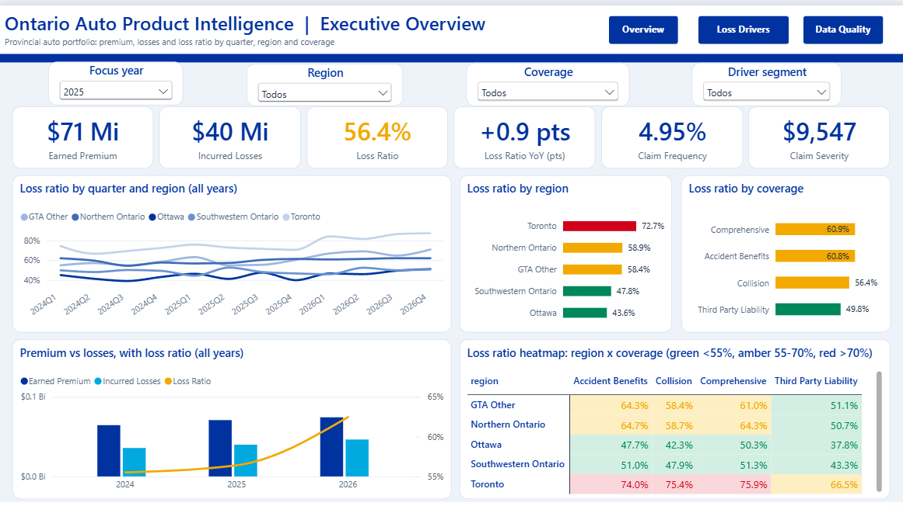
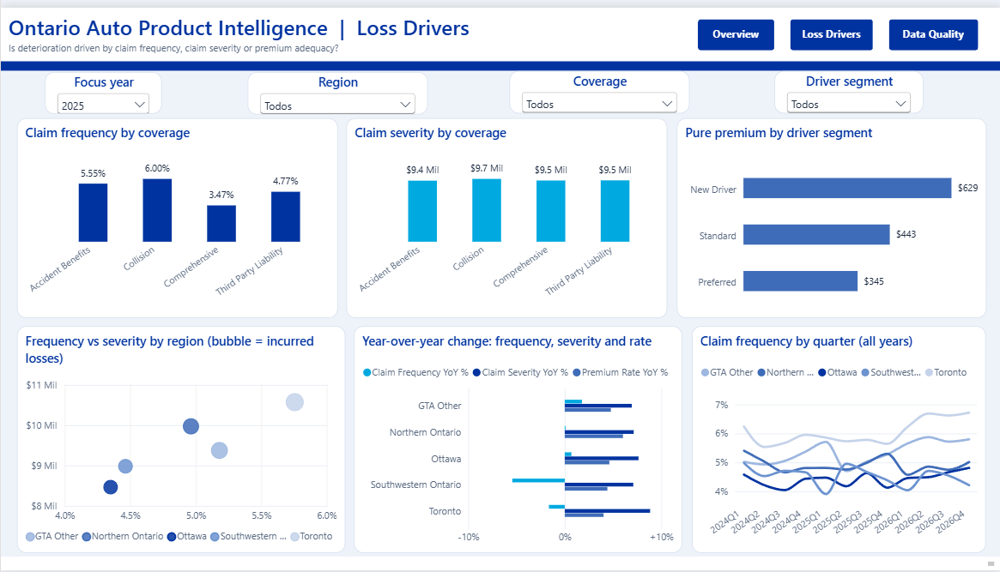
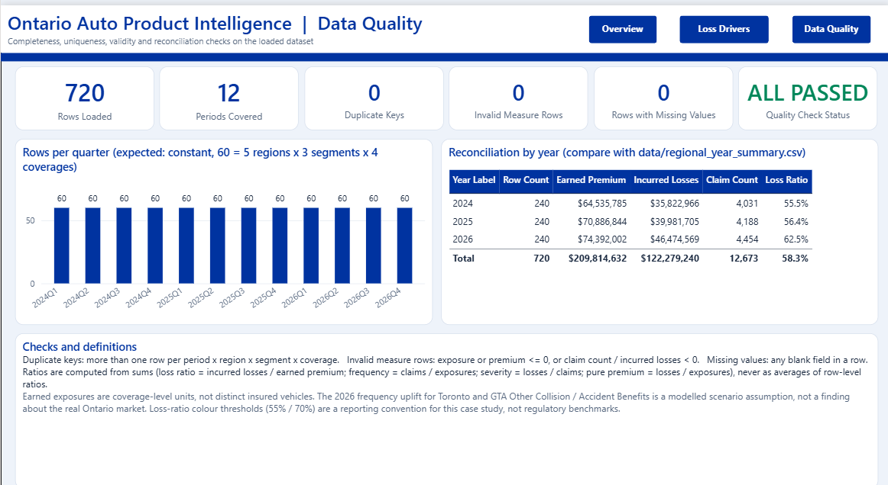

# Report screenshots

The final Power BI report has three pages. The following screenshots are captured from Power BI Desktop using the **2025** focus-year view, with regional and segment controls available for further investigation.

### Executive Overview

### Loss Drivers

### Data Quality

The dashboard is an independent case study built with synthetic data, not an Allstate Canada report. The 2025 screenshot shows a loss ratio of 56.4%; the 2026 simulated portfolio loss ratio is 62.5%.
